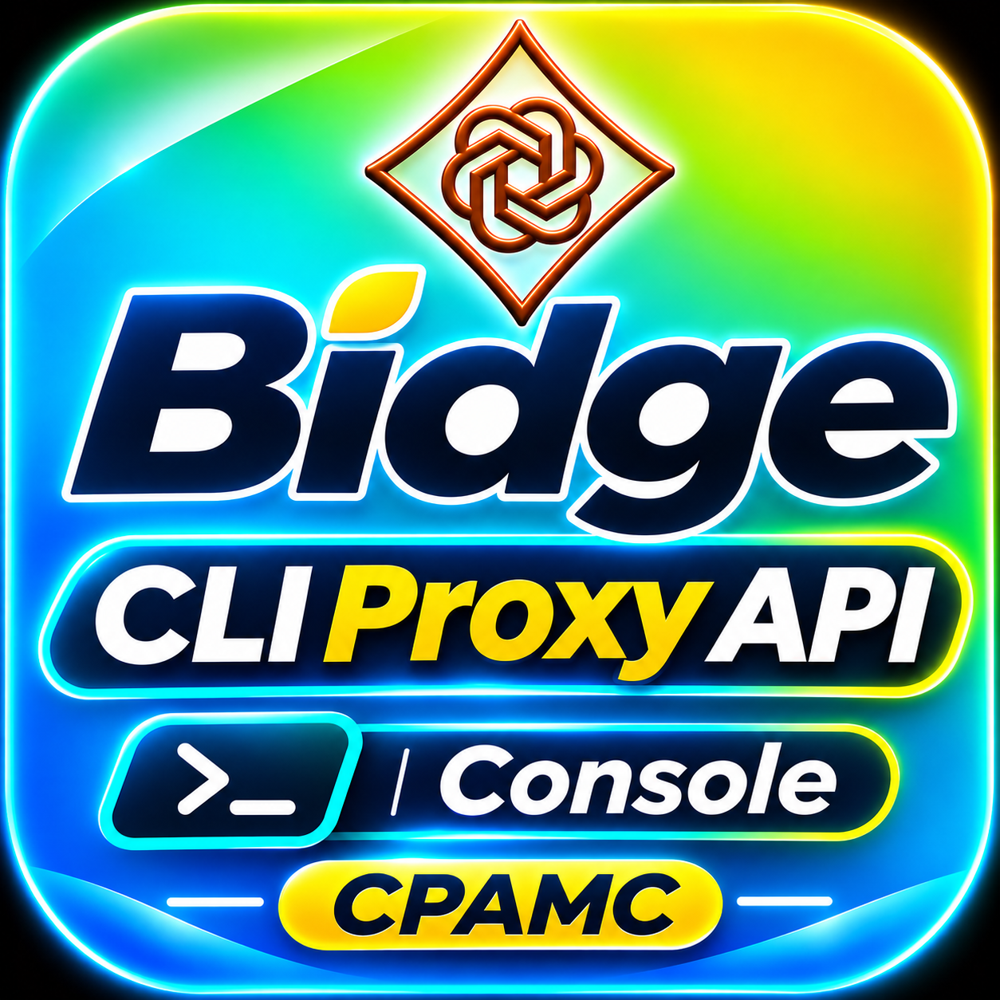

<p align="center">
  
</p>

# Bridge CPAMC Oficial

[](https://gentlemanprogramming.com/gentle-hub/)
[](https://github.com/router-for-me/CLIProxyAPI)
[](https://bit.ly/48zTJUo)
[](LICENSE)

Puente universal, instalador automatizado y adaptador de modelos para conectar **Gentle Shell** y **Pi** con el proyecto oficial **CPAMC (CLIProxyAPI)**. Diseñado para cualquier sistema operativo (**Linux, macOS, Windows nativo**) y cualquier topología (**Binario local, Docker o VPS Remoto**).

> 📌 **Repositorio Oficial Upstream:** [router-for-me/CLIProxyAPI](https://github.com/router-for-me/CLIProxyAPI)  
> *Este repositorio es la puerta de entrada, instalador y asistente de integración para la comunidad de Gentle Shell y Gentle Hub. Todo el software y binarios descargados provienen directamente y sin alteraciones de los releases oficiales de `router-for-me`.*

> 💬 **Comunidad y Soporte Oficial:** `wilox2` · [Servidor de Discord](https://bit.ly/48zTJUo)

> 🤖 **Para Instalación Asistida por AI (Claude, Pi, Cursor):** Consulta estrictamente [AI_INSTALL.md](AI_INSTALL.md). Este paquete es un **Proveedor Headless**, NO debe generar widgets en chat.

---

## 🗺️ Flujo de Conexión en 5 Pasos

```
┌────────────────────────────────────────────────────────────────────────┐
│                      FLUJO DE CONEXIÓN EN 5 PASOS                      │
└────────────────────────────────────────────────────────────────────────┘

 [1. INSTALACIÓN]          [2. DESCARGA OFICIAL]        [3. LANZAMIENTO]
  gentle-shell install       /cpamc install              /cpamc start
   (Instala el puente)  ──▶ (Baja el binario de)   ──▶  (Inicia en puerto)
                            (router-for-me)             (127.0.0.1:8317)
                                                               │
                                                               ▼
 [5. A PROGRAMAR]          [4b. SINCRONIZACIÓN]         [4a. CONSOLA WEB]
  Escribe /model            /cpamc doctor & refresh      Abre en navegador:
  Elige cpamc/*         ◀── (Gentle detecta los)   ◀──  :8317/management.html
  ¡Y empieza a codear!      (modelos configurados)       (Vincula tus cuentas)
```

---

## 🧙 Asistente Híbrido: Wizard Mixto (`/cpamc wizard`)

El puente incluye un **Wizard Mixto** que te guía paso a paso combinando la terminal, la consola web y tus archivos de sesión:

```text
/cpamc wizard
```

El asistente detecta automáticamente tu entorno (Mac, Linux, Windows, Docker o VPS) y te asiste en:
1. **Verificación de binario/servicio:** Lo descarga o inicia si está apagado.
2. **Vinculación de Cuentas:** Abre la consola oficial en el navegador para OAuth o te permite registrar archivos de autenticación adicionales.
3. **Multi-cuenta y Auto Switcher Pro:** Detecta si tienes 2 o más cuentas del mismo proveedor y activa el pool de balanceo automático contra errores 429.
4. **Sincronización a `/model`:** Deja todos tus modelos listos y ordenados de inmediato.

---

## 💻 Instalación por Sistema Operativo y Topología

### 1. Desde Gentle Shell (Recomendado para todos los OS)
```bash
gentle-shell install git:github.com/WiloxDev/bridge-cpamc-oficial
```
Luego ejecuta:
```text
/cpamc wizard
```

---

### 2. Instalación Directa por Terminal

#### 🐧 Linux (Ubuntu, Debian, Fedora, Arch) y macOS (Apple Silicon / Intel)
```bash
curl -fsSL https://raw.githubusercontent.com/WiloxDev/bridge-cpamc-oficial/main/scripts/install-official.sh | bash
```

#### 🪟 Windows Nativo (PowerShell sin WSL)
Abre PowerShell como usuario normal y ejecuta:
```powershell
irm https://raw.githubusercontent.com/WiloxDev/bridge-cpamc-oficial/main/scripts/install-official.ps1 | iex
```

#### 🐳 Docker & Docker Compose
Si prefieres correr CPAMC aislado en un contenedor:
```bash
# Descarga la plantilla oficial y arráncala
curl -fsSL https://raw.githubusercontent.com/WiloxDev/bridge-cpamc-oficial/main/docker-compose.yml -o docker-compose.yml
docker compose up -d
```
Luego en Gentle Shell indica la conexión:
```text
/cpamc set-url http://127.0.0.1:8317
```

#### ☁️ VPS Remoto / Red Local / Servidor de Oficina
Si CPAMC está corriendo en un servidor remoto asegurado:
```text
/cpamc set-url https://tu-vps.com:8317
/cpamc set-key TU_TOKEN_SECRETO
```

---

## 🔄 Sistema Multi-Cuenta y Rotación Automática

### ¿Cómo tener 2 o más cuentas del mismo proveedor?
1. **Primera cuenta:** Inicia sesión con el botón OAuth en `http://127.0.0.1:8317/management.html` (Google Antigravity, Claude Code, OpenAI Codex, etc.).
2. **Segunda o tercera cuenta (Mismo proveedor):** Agrega tu segundo archivo de autenticación en la pestaña *Auth Files* o en la carpeta `~/.cli-proxy-api/auths/`.
3. **Rotación automática sin caídas:** Al usar el plugin complementario [cpamc-auto-switcher-pro](https://github.com/WiloxDev/cpamc-auto-switcher-pro), tus cuentas se balancean automáticamente. Si una cuenta alcanza el límite 429 de cuota, el puente conmuta a la siguiente cuenta en milisegundos sin cortar el chat ni la generación de código.

### ¿Cómo aparecen en el menú `/model`?
Escribe `/model` en Gentle Shell. El catálogo se sincroniza de forma orgánica:
- **`cpamc/claude-3-5-sonnet [Pool Auto-Switch]`**: Protegido con múltiples cuentas.
- **`cpamc/deepseek-reasoner [Reasoning]`**: Con capacidad de pensamiento analítico.
- **`cpamc/gemini-2.0-flash`**: Con contexto masivo de 1M tokens.

---

## 🚀 Resumen de Comandos en Gentle Shell (`/cpamc`)

- `/cpamc wizard` — Asistente interactivo guiado paso a paso.
- `/cpamc install` — Descarga la última versión oficial desde `router-for-me/CLIProxyAPI/releases`.
- `/cpamc start` — Inicia el servicio local en segundo plano en `http://127.0.0.1:8317`.
- `/cpamc doctor` — Diagnóstico integral de binario, conectividad y estado del upstream.
- `/cpamc refresh` — Actualiza la lista de modelos de Gentle Shell tras agregar cuentas.
- `/cpamc set-url <url>` — Configura la URL de CPAMC (para Docker o VPS remoto).
- `/cpamc set-key <token>` — Configura el API Key / Bearer token de acceso remoto.
- `/cpamc official` — Abre el enlace directo y créditos al repositorio upstream oficial.

---

## 🖥️ Consola de Administración Web

Accede a la interfaz web oficial de CPAMC para vincular proveedores:  
👉 **[http://127.0.0.1:8317/management.html](http://127.0.0.1:8317/management.html)**

---

## 📄 Créditos y Licencia

MIT © Wilox. Basado en y para uso con [router-for-me/CLIProxyAPI](https://github.com/router-for-me/CLIProxyAPI). Agradecimientos y créditos al equipo de CLIProxyAPI y a la comunidad de Gentle Shell.
